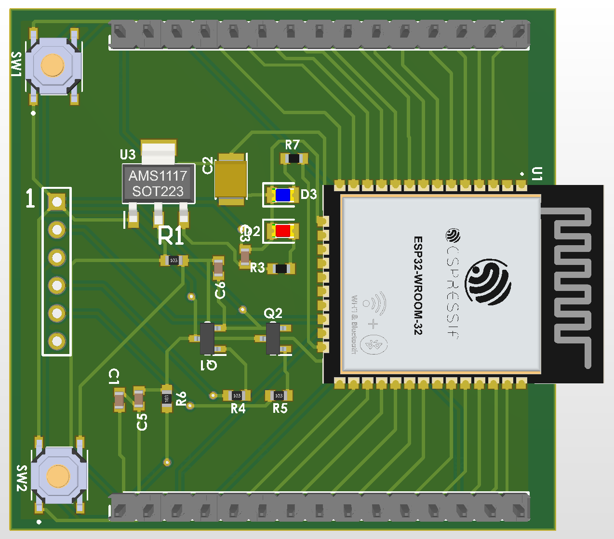
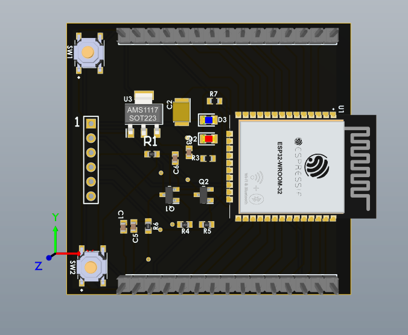
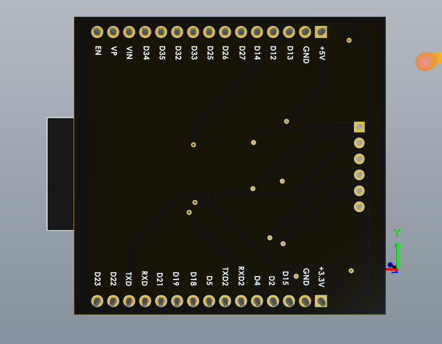
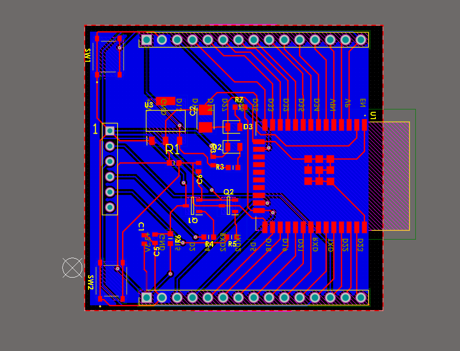
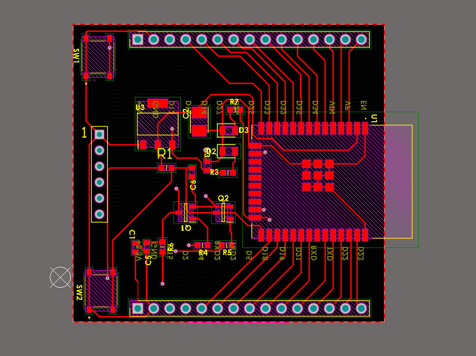
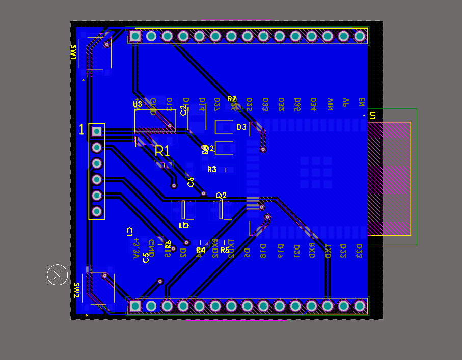
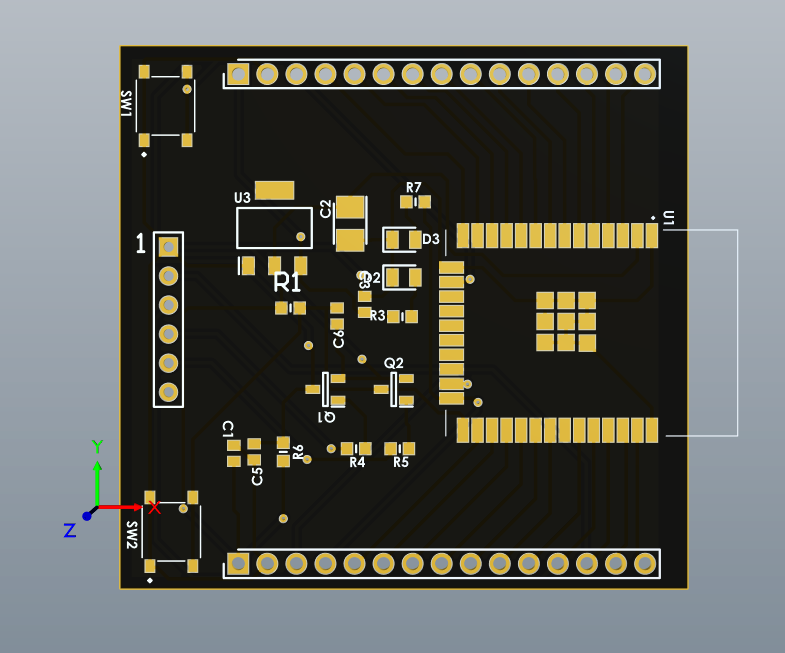
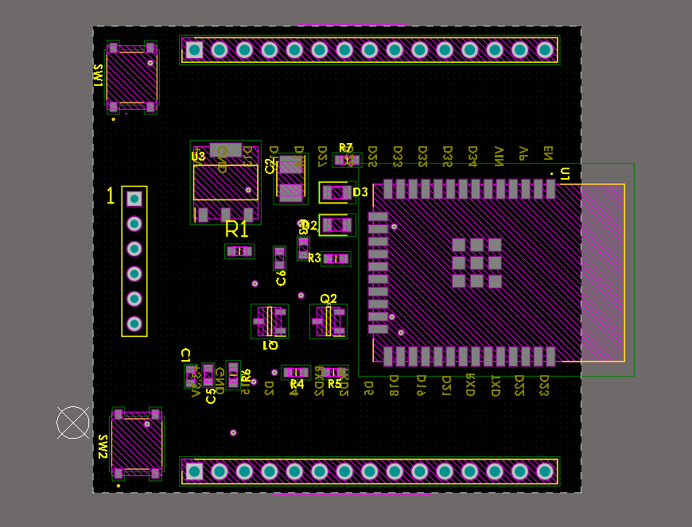

ESP32 Custom Development Module

A custom-designed ESP32-based hardware development module, featuring a dedicated PCB, power regulation circuitry, boot and programming support, and a compact hardware architecture.

This project covers the complete hardware design process, from schematic development and PCB layout to 3D modeling, component selection, and manufacturing documentation.

Project Overview

The ESP32 Custom Development Module is designed to provide a reusable hardware platform for embedded systems and IoT applications.

The board is based on the ESP32-WROOM module and integrates the essential supporting circuitry required for reliable operation and development.

Key Features

- Microcontroller: ESP32-WROOM series
- Custom PCB Design: Dedicated PCB designed from scratch
- Power Management: Dedicated power input and regulation circuitry
- Voltage Regulation: 3.3V regulated supply
- Boot Circuitry: Dedicated boot and reset support
- Programming Support: Hardware provisions for firmware uploading
- PCB Design: Custom schematic and multilayer PCB layout
- 3D Design: 3D PCB visualization and mechanical integration
- Manufacturing: Gerber and NC Drill manufacturing outputs

Hardware Design

The hardware development includes:

- Complete electronic schematic design
- PCB component placement and routing
- Power supply and voltage regulation design
- ESP32 boot and programming circuitry
- Component library development
- PCB manufacturing preparation
- 3D board modeling

Project Images

3D PCB Render

## Project Gallery

### 3D PCB Renders

### PCB Layout

Directory / File| Description
"3D/"| 3D models and PCB visualization files
"BOM/"| Bill of Materials
"Documentation/"| Technical documentation
"Gerber/"| PCB manufacturing files
"Images/"| Project images and renders
"Library/"| Custom electronic component libraries
"NC Drill/"| PCB drilling files
"ESP32-Custom_Module.PcbDoc"| PCB layout design
"ESP32-Custom_Module.SchDoc"| Electronic schematic
"ESP32-Custom_Module.PrjPcb"| Main Altium project
"ESP32-Custom_Module.OutJob"| Manufacturing output configuration

Design Software

- Altium Designer
- PCB 3D modeling tools

Manufacturing

The repository includes the necessary manufacturing documentation, including:

- Gerber files
- NC Drill files
- Bill of Materials (BOM)
- PCB design source files

These files provide the basis for PCB fabrication and assembly.

Project Scope

This project demonstrates practical experience in:

- Embedded hardware development
- ESP32-based system design
- Electronic circuit design
- PCB layout and routing
- Power supply design
- Hardware development and engineering documentation

---

Designed and developed by Javad

Electronics Design | Embedded Systems | PCB Development
